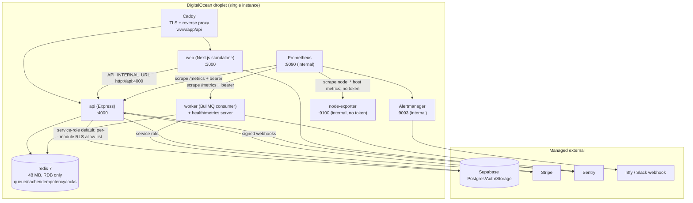

# Architecture and Runtime Topology — re-audit verification

## Audit Metadata

- Audit name: repo-deep-dive (full-domain verification re-audit)
- Run: `mainecybertech-20261103-0748-full-main-6b7aa1a`
- Repository: `MaineCyberTech/mainecybertech`
- Branch / Commit: `origin/main` @ `6b7aa1a5505d4f75b334b36e9e87737cd98e589c`
- Generated at: 2026-11-03 (UTC)
- Auditor: subagent (re-audit of `mainecybertech-20261014-0033-full-main-7dd0402`)
- Area code: ARCH
- Scope limitations: read-only static review; no live droplet, no docker runtime deployment, no Alertmanager delivery test. Prometheus rules were executed with promtool in Docker; compose config was rendered locally.

## Scope

Re-verified all 10 previous ARCH findings at `6b7aa1a`: single-droplet/SPOF topology, service-role DB default, Prometheus alert routing, queue-backend parity, single Redis, web middleware gate, architecture docs/ADR, runtime `NEXT_PUBLIC_API_URL` behaviour, request cancellation and worker metrics auth. The diff added node-exporter plus host-resource alerts, refreshed the proxy last in deploy (zero-downtime caddy recreate), bumped Prometheus/Alertmanager images and added the architecture-diagram node.

## System / container diagram (as-built at 6b7aa1a5)



Hidden couplings: `QUEUE_BACKEND=bullmq` must match between API and worker; `API_INTERNAL_URL` is a runtime SSR coupling; `METRICS_TOKEN` is shared by API/worker/Prometheus; Redis is a single shared dependency for queue, cache, idempotency and scan locks; `SUPABASE_SERVICE_ROLE_KEY` is the DB capability for both deployables and the unsubscribe-token HMAC key.

## Domain scorecard

| Category | Score | Evidence | Gap | Recommended action |
|---|---:|---|---|---|
| Topology clarity | 4 | Compose + diagram + ADR match | Live runtime unverified | Keep diagram current when services change |
| Availability | 2 | Single droplet/instance; rolling recreate | Host loss = full outage | Fund HA/warm standby |
| Alerting | 3 | Prometheus+Alertmanager+Watchdog; host rules | No node-exporter liveness | Add `up` rule |
| Queue parity | 4 | Shared `QUEUE_BACKEND`, boot refusal | Redis single point | Replicate/split Redis |
| Tenant boundary | 2 | RLS allow-list rollout; service-role default | Writes default bypass | Continue rollout |
| Request lifecycle | 4 | Timeout abort + socket destroy | Handlers must honour signal | Add per-route usage tests |
| Observability auth | 4 | API/worker metrics token | node-exporter tokenless by design | Documented |
| Docs/as-built parity | 4 | Diagram/ADR/runbooks updated | No live verification | Read-only drill |

## Evidence Reviewed

| Evidence | Type | Why relevant | Notes |
|---|---|---|---|
| `infra/digitalocean/docker-compose.yml` | Read/Executed | Runtime topology + new exporter | `docker compose config` exit 0 |
| `infra/terraform/digitalocean/droplet.tf` | Read | Single droplet | One `digitalocean_droplet.portal` |
| `infra/digitalocean/prometheus.yml`, `prometheus.rules.yml`, `prometheus.rules.test.yml` | Executed/Read | Scrape + alerting | promtool 26 rules + tests SUCCESS |
| `infra/digitalocean/alertmanager.tmpl.yml` | Read | Receivers/watchdog | Critical/default/ntfy routes |
| `.github/workflows/deploy-do.yml` | Read | Deploy/rolling recreate/health gate | Caddy in-place recreate; `GATED_SERVICES` includes node-exporter |
| `apps/api/src/services/supabase.ts`, `lib/rls-startup-check.ts` | Read | Service-role default | Blocked boot only for empty reads |
| `apps/api/src/lib/task-producer.ts`, `config/env.ts`, `worker/src/env.ts` | Read | Queue parity | Both read QUEUE_BACKEND |
| `apps/web/middleware.ts`, `lib/api.ts` | Read | JWT UX gate + internal URL | Documented non-authoritative |
| `apps/api/src/middleware/request-timeout.ts`, `apps/worker/src/health-server.ts` | Read | Timeout/metrics auth | Abort signal + token |
| `docs/ARCHITECTURE_DIAGRAM.md`, `docs/adr/README.md`, `docs/PLATFORM_FAILURE_RUNBOOKS.md` | Read | Docs/decisions | Node-exporter + rolling recreate documented |

## Verification Performed

| Evidence | Type | Why relevant | Notes |
|---|---|---|---|
| `promtool check rules` | Executed | Alert syntax | SUCCESS: 26 rules |
| `promtool test rules` | Executed | Alert behaviour | SUCCESS |
| `docker compose ... config` | Executed | Compose validity with new service | exit 0; node-exporter resolved |
| Scrape-rule inventory | Read | Target-down coverage | Only `mct-api|mct-worker` have `up==0` |
| Deploy workflow read | Read | Rolling/zero-downtime path | Caddy refresh last |
| No live droplet/alert delivery | Not run | Cannot prove infra state | Documented limitation |

## Executive Summary

6 of 10 previous ARCH findings are **verified fixed**; 4 remain **partially fixed** (`ARCH-P2-001`, `ARCH-P2-002`, `ARCH-P2-005`, `ARCH-P3-001`); 0 regressed.

The architecture is still a single droplet with one API/worker/web instance and one non-replicated Redis, and the API still defaults to the service-role DB client for modules not on the RLS allow-list. Those are owner/accepted decisions, not regressions. This diff improves operations: caddy is refreshed last via an in-place `--force-recreate` (no stop-the-world), the deploy health gate includes the new node-exporter, and host disk/memory alerts fill the previous "host full, all service rules green" gap.

One **new P3** was found: the new host-resource alerting has no liveness rule for `node-exporter` itself. `prometheus.rules.yml` alerts only on `up{job=~"mct-api|mct-worker"} == 0`; if the exporter stops being scraped, the disk/memory alerts silently go absent while Alertmanager and the Watchdog stay green.

## Findings

| ID | Sev | Status | Title |
|---|---|---|---|
| ARCH-P2-001 | P2 | partially-fixed | Single-droplet, single-instance runtime is a hard SPOF |
| ARCH-P2-002 | P2 | partially-fixed | API defaults to the service-role DB client (RLS bypass) |
| ARCH-P2-003 | P2 | verified-fixed | Prometheus loads rules but has no alert routing |
| ARCH-P2-004 | P2 | verified-fixed | API always enqueues to BullMQ while the worker backend is a separate setting with no parity check |
| ARCH-P2-005 | P2 | partially-fixed | One non-replicated Redis backs queue, cache, idempotency and scan locks; failure degrades silently |
| ARCH-P3-001 | P3 | partially-fixed | Web middleware gates routes on an unverified JWT `exp` |
| ARCH-P3-002 | P3 | verified-fixed | Architecture diagram and ADR 004 contradict the as-built runtime |
| ARCH-P3-003 | P3 | verified-fixed | `NEXT_PUBLIC_API_URL` runtime override is inert for server-side code; docs claim internal SSR routing |
| ARCH-P3-004 | P3 | verified-fixed | Request timeout returns 408 but never cancels the handler |
| ARCH-P3-005 | P3 | verified-fixed | Worker metrics/health are unauthenticated while the API gates `/metrics` |
| ARCH-P3-006 | P3 | open | Host-resource alerting has no liveness rule for the new node-exporter |

Counts: **6 verified-fixed, 4 partially-fixed, 0 regressed, 1 new P3 open.**

## Partially fixed — exact residuals

- **ARCH-P2-001 (SPOF):** still one droplet and one instance per service (`docker-compose.yml`; `droplet.tf:1-15`). The planned-downtime component is removed by the rolling per-service recreate plus in-place caddy refresh (`deploy-do.yml:1027-1050`); host loss is still a full outage and is documented/accepted (`PLATFORM_FAILURE_RUNBOOKS.md:11-13`). No HA replica set, load balancer or warm standby.
- **ARCH-P2-002 (service-role default):** `getScopedClient` returns the service-role client unless the module is listed in `RLS_READS_ENABLED`/`RLS_WRITES_ENABLED` (`services/supabase.ts:197-224`). Production refuses an empty **read** allow-list (`lib/rls-startup-check.ts:44-55`), but an empty **write** allow-list only logs (`:57-63`), and platform admins bypass RLS by design. The per-module rollout remains owner-gated (`docs/RLS-rollout.md`).
- **ARCH-P2-005 (single Redis):** one `redis:7-alpine` with 48 MB cap, RDB-only persistence, no replication/maxmemory. Degradation is metered and alerted (`prometheus.rules.yml:390-455`), but an OOM kill still loses queue/lock/idempotency state.
- **ARCH-P3-001 (unverified JWT exp):** `apps/web/middleware.ts:4-16` explicitly documents the gate as non-authoritative UX; a forged-but-unexpired cookie reaches only the shell, every server component re-checks via the API. Residual accepted; there is still no assertion/test that no data access depends on `isAuthenticated`.

## New finding

### ARCH-P3-006 — no liveness alert for node-exporter (P3, open)

- **Evidence:** `infra/digitalocean/prometheus.yml:47-53` adds the `node-exporter` job; `prometheus.rules.yml:459-505` adds `MCTHostDiskSpaceLow/Critical` and `MCTHostMemoryPressure`; the only target-down rule is `up{job=~"mct-api|mct-worker"} == 0` (`prometheus.rules.yml:11-20`). The deploy health gate includes the container (`deploy-do.yml:1070`), but runtime scrape loss is not alerted.
- **What is happening:** if the exporter crashes, its scrape is blocked, or it is misconfigured, the `node_*` series disappear; Prometheus rules referencing them simply stop firing, and the external Watchdog continues to report the stack healthy.
- **Why it matters:** the host-resource alarms added in this release are the only warning before a full disk/memory outage on the single droplet; losing them silently reopens the failure mode they were added to close.
- **Recommended fix:** add `up{job="node-exporter"} == 0` (or `absent(node_filesystem_avail_bytes{mountpoint="/"})`) with `severity: warning/critical` and a `for: 5m`, routed to the same receiver.
- **Validation:** `promtool test rules` case with the target down; verify the alert fires and the Watchdog remains independent.
- **Owner:** platform/observability · **Effort:** S · **Target:** next quarter.

## Risks

| Risk | Severity | Likelihood | Impact | Evidence | Mitigation |
|---|---|---|---|---|---|
| Host runs out of disk/memory | P2 | Medium (prior 98% disk incident) | Full stack outage | New host rules; no liveness rule | Add exporter `up` alert |
| Single droplet/host loss | P2 | Low–Medium | Full outage until rebuild | ARCH-P2-001 | Accepted; restore runbook |
| Redis OOM/restart | P2 | Medium | Lost queue/locks/idempotency | ARCH-P2-005 | Replication/split; alerts exist |
| RLS bypass by default | P2 | High until rollout | App-layer only isolation | ARCH-P2-002 | Continue per-module rollout |
| Forged-exp cookie reaches shell | P3 | Low | UI-only, no data | ARCH-P3-001 | API verification + test |

## Recommendations

### Immediate / Release Blocking

None.

### This Week

1. Add the node-exporter liveness rule and a promtool test (`ARCH-P3-006`).

### This Month

2. Add an assertion/test that no web data access depends on the middleware `isAuthenticated` result (`ARCH-P3-001` residual).
3. Continue the RLS write-module rollout or make the production check fail closed for writes too, with an explicit exception list (`ARCH-P2-002`).

### Later / Platform Evolution

4. Decide on Redis replication/HA and a second app instance or warm standby (`ARCH-P2-001`/`ARCH-P2-005`) with a cost/availability decision.

## Quick Wins

| Quick win | Why it helps | Files likely involved | Validation |
|---|---|---|---|
| Exporter `up` alert | Keeps host monitoring honest | `prometheus.rules.yml` | promtool test |
| `absent()` guard on disk series | Catches missing metrics | `prometheus.rules.yml` | promtool test |
| Document exporter tokenless stance | Avoid confusion vs API/worker metrics | `docs/MONITORING_AND_ALERTING.md` | Already documented at :308 |

## Hardening Backlog

| Backlog item | Priority | Owner suggestion | Effort | Dependency |
|---|---|---|---|---|
| node-exporter liveness alert (ARCH-P3-006) | P3 | platform/observability | S | None |
| HA/warm standby decision (ARCH-P2-001) | P2 | owner/infra | L | Budget |
| Redis replication/split (ARCH-P2-005) | P2 | infra | M–L | Budget |
| Complete RLS write rollout (ARCH-P2-002) | P2 | API/security | M | Per-module plan |
| Middleware-gate assertion test (ARCH-P3-001) | P3 | web/security | S | None |

## Suggested Tests

- `promtool test rules`: node-exporter target down → `MCTNodeExporterDown`; disk 10% → warning; 5% → critical; memory 95% → warning.
- `docker compose config` with the production env file (already exit 0).
- Deploy dry-run: caddy refresh failure falls back to `--force-recreate` and still health-gates.
- Middleware: forged-exp cookie renders shell only; no server component returns tenant data without API auth.

## Suggested Documentation Updates

- `docs/MONITORING_AND_ALERTING.md` alert table: add the exporter liveness alert.
- `docs/PLATFORM_FAILURE_RUNBOOKS.md`: add "host metrics missing" triage.
- `docs/RLS-rollout.md`: state the write allow-list is advisory and list the exception modules.

## Open Questions

| Question | Why it matters | Evidence needed |
|---|---|---|
| Is a second app instance/warm standby funded? | Closes ARCH-P2-001 | Owner/budget decision |
| When will the RLS write rollout complete? | Determines ARCH-P2-002 closure | Rollout plan |
| Is Redis persistence RPO 24h acceptable for queue loss? | Determines replication need | Business continuity decision |
| Has any host alert fired/tested in a real environment? | Proves the new rules | Alertmanager history |

## Appendix — executed commands

```
docker run --rm -v "$PWD/infra/digitalocean:/cfg:ro" --entrypoint /bin/promtool \
  prom/prometheus:v3.5.1 check rules /cfg/prometheus.rules.yml
  -> SUCCESS: 26 rules found

docker run --rm -v "$PWD/infra/digitalocean:/cfg:ro" --entrypoint /bin/promtool \
  prom/prometheus:v3.5.1 test rules /cfg/prometheus.rules.test.yml
  -> SUCCESS

SUPABASE_URL=... SUPABASE_ANON_KEY=... SUPABASE_SERVICE_ROLE_KEY=... JWT_SECRET=... \
REDIS_PASSWORD=... IMAGE_TAG=... docker compose -f infra/digitalocean/docker-compose.yml config
  -> exit 0
```

No live droplet, container restart, deployment, or alert delivery was performed.
